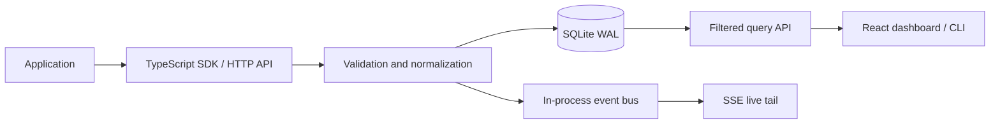

# Log Arithmic

**A self-hosted structured log explorer for application developers.** Log Arithmic
accepts JSON events over HTTP, stores them in SQLite, and lets you search,
inspect, export, and tail logs from a compact developer dashboard.

> Release `0.1.0` is an intentionally small, single-node foundation. It does
> not claim distributed ingestion, OpenTelemetry compatibility, or production
> benchmarks that have not been measured on your hardware.

## Features

- Single and transactional batch ingestion with validation and scoped API keys
- Persistent SQLite storage with WAL mode, indexed timestamp/service/level/trace
  lookups, and cursor pagination
- Filters for time, project/environment scope, service, level, trace/request ID,
  and message text
- React log explorer, event details/raw JSON, trace lookup API, and live tail
- SDK with asynchronous batching, explicit `flush()`/`shutdown()`, and bounded queue
- CLI for health, projects/services, log export, and following the live stream
- JSON, NDJSON, and CSV export; scheduled local retention cleanup
- Docker Compose, health/readiness endpoints, CI, and a real ingestion benchmark

## Architecture



The HTTP layer, key management, normalization, storage interface, query API, and
event bus are separate modules in one Bun process. SQLite uses direct,
parameterized SQL rather than an ORM. Inserts in a batch share one transaction.
Event IDs include a timestamp-derived sortable prefix; timestamps are stored as
UTC ISO-8601 strings. Indexes match common project, service, level, environment,
and trace queries. Message search currently uses case-insensitive substring
matching (`instr(lower(message), ...)`), not an FTS index. This is predictable
for local datasets but should be upgraded to FTS5 before claiming large-scale
search performance.

The live stream is authenticated SSE rather than WebSockets: it keeps server
complexity low and supports browser streaming with bearer headers. Delivery is
best-effort and in-process; disconnected/slow subscribers are removed and never
block persistence.

## Quick start (local)

Requirements: Bun 1.x.

```sh
bun install
bun run dev
```

On first startup, Log Arithmic generates a secure admin token and saves it to
`data/log-arithmic.sqlite.admin-token`. Keep that file private; it is ignored by Git.
In PowerShell, load it and create a scoped API key:

```powershell
$env:LOG_ARITHMIC_ADMIN_TOKEN = (Get-Content .\data\log-arithmic.sqlite.admin-token -Raw).Trim()
curl.exe -X POST http://127.0.0.1:8787/api/v1/keys \
  -H "Authorization: Bearer $env:LOG_ARITHMIC_ADMIN_TOKEN" \
  -H "Content-Type: application/json" \
  -d '{"project":"demo","environment":"development"}'
```

The `secret` is shown once. Save it securely as `LOG_ARITHMIC_API_KEY`. Start the
dashboard in another terminal with `bun run dashboard:dev`; open
<http://localhost:5173> and enter the project key. Check API health at
<http://127.0.0.1:8787/health>.

You can optionally copy `.env.example` to `.env` to change the port, database,
retention, and other settings. If you explicitly set `LOG_ARITHMIC_ADMIN_TOKEN`, it
must be at least 32 characters long.

## Docker

Docker is optional. If you choose to use it, copy `.env.example` to `.env` and
set a unique `LOG_ARITHMIC_ADMIN_TOKEN`, then:

```sh
docker compose up --build
```

Open <http://localhost:5173>. The API is also reachable on
<http://localhost:8787>; SQLite data persists in the `log-arithmic-data` volume.
Create a key as above. Back up the SQLite volume consistently; do not treat
copying a live WAL database file alone as a verified backup.

## TypeScript SDK

The workspace SDK is in `packages/sdk`. In an application using Bun workspaces:

```ts
import { LogForge } from "@logforge/sdk";

const logger = new LogForge({
  endpoint: "http://localhost:8787",
  apiKey: process.env.LOG_ARITHMIC_API_KEY!,
  service: "payments",
  environment: "development",
});

logger.info("Application started", { metadata: { version: "0.1.0" } });
logger.error("Payment failed", {
  traceId: "tr_123",
  metadata: { orderId: 42, provider: "example" },
});
await logger.flush();
await logger.shutdown();
```

The SDK buffers events and sends batches in the background. Failed batches stay
queued and are retried on a later flush; asynchronous failures go to `onError`
(or `console.error` by default). The queue is bounded to avoid unbounded memory
growth. Call `shutdown()` on process shutdown to flush remaining events.

## API

All endpoints are rooted at `/api/v1`. Except health/readiness and admin key
management, requests require `Authorization: Bearer lf_…`. API keys are stored
as SHA-256 digests and scoped to exactly one project and environment.

| Method | Path | Purpose |
|---|---|---|
| `POST` | `/api/v1/keys` | Create project/environment key (admin bearer) |
| `GET` | `/api/v1/keys` | List key metadata (admin bearer; never returns secrets) |
| `DELETE` | `/api/v1/keys/:id` | Revoke an active key (admin bearer) |
| `POST` | `/api/v1/logs` | Ingest one event |
| `POST` | `/api/v1/logs/batch` | Transactional batch ingestion |
| `GET` | `/api/v1/logs` | Filter, query, and cursor-page logs |
| `GET` | `/api/v1/logs/:id` | Inspect one event |
| `GET` | `/api/v1/traces/:traceId` | View events sharing a trace ID |
| `GET` | `/api/v1/logs/export?format=json\|ndjson\|csv` | Export up to 5,000 events |
| `GET` | `/api/v1/stream` | Authenticated filtered SSE event stream |
| `GET` | `/api/v1/projects` | Current project and its services |
| `GET` | `/api/v1/metrics` | Basic process and ingestion counters |

Query parameters: `from`, `to`, `level`, `service`, `traceId`, `requestId`,
`search`, `cursor`, and `limit` (1–500). Results order newest-first. The
`nextCursor` in a response can be passed as `cursor` to fetch the next page.
Batch bodies use `{ "logs": [...] }`; the default maximum batch is 500 events.
Timestamps accept ISO strings or epoch milliseconds. Invalid events reject the
whole batch rather than silently ingesting a partial request.

```sh
curl http://127.0.0.1:8787/api/v1/logs?level=error \
  -H "Authorization: Bearer $LOGFORGE_API_KEY"
```

## CLI

```sh
export LOG_ARITHMIC_URL=http://127.0.0.1:8787
export LOG_ARITHMIC_API_KEY=lf_...
bun run cli health
bun run cli projects
bun run cli logs --service payments --level error --format ndjson
bun run cli logs --follow
bun run cli logs --trace tr_123
```

## Configuration

See [.env.example](./.env.example). Bun loads `.env` automatically.
The `LOGFORGE_*` server variables and CLI `LOGFORGE_URL`/`LOGFORGE_API_KEY`
remain accepted as deprecated aliases; prefer the `LOG_ARITHMIC_*` names for
new installations.

| Variable | Default | Description |
|---|---|---|
| `LOG_ARITHMIC_HOST` | `127.0.0.1` | Bind address; use `0.0.0.0` in containers |
| `LOG_ARITHMIC_PORT` | `8787` | HTTP port |
| `LOG_ARITHMIC_DATABASE` | `./data/log-arithmic.sqlite` | SQLite file path |
| `LOG_ARITHMIC_ADMIN_TOKEN` | generated locally | Admin bearer secret; configured values need at least 32 characters |
| `LOG_ARITHMIC_RETENTION_DAYS` | `30` | Cleanup age; `0` disables cleanup |
| `LOG_ARITHMIC_CORS_ORIGIN` | `http://localhost:5173` | Allowed browser origin |
| `LOG_ARITHMIC_RATE_LIMIT` | `120` | Ingestion requests per minute per API key |
| `LOG_ARITHMIC_MAX_BATCH_SIZE` | `500` | Maximum events per batch |
| `LOG_ARITHMIC_MAX_REQUEST_BYTES` | `1048576` | Maximum request body size |

## Security

Generate a high-entropy admin token and do not expose the admin key endpoints to
untrusted networks. API secrets are returned only at creation, stored hashed,
and should be scoped to one project/environment. Use TLS when crossing an
untrusted network, restrict database file permissions, configure CORS narrowly,
and rotate/revoke keys when needed. Ingestion is rate-limited in process;
deployments behind a reverse proxy should also impose connection and request
timeouts. Query/export/stream calls require a scoped key; user-provided SQL is
never executed. Metadata is size-limited and JSON-normalized. No secrets are
logged by the server.

## Development and tests

```sh
bun test
bun run typecheck
bun run dashboard:build
```

The tests cover configuration/normalization, key hashing and revocation, SQLite
query/cursor/retention behavior, event-bus filtering, authenticated ingestion,
trace/export routes, SSE delivery, and SDK batching/retry.

Run an actual local ingestion benchmark against an already-running server and a
fresh project key:

```sh
LOG_ARITHMIC_API_KEY=lf_... bun run benchmark:ingest
```

Optional settings: `BENCHMARK_EVENTS` (default `10000`),
`BENCHMARK_BATCH_SIZE` (default `250`), and `LOG_ARITHMIC_URL`. The command reports
measured throughput and batch latency for the current machine/database; results
depend on storage, runtime, and load. It does not fabricate or infer performance
claims.

## Limitations and roadmap

This `0.1.0` release is single-process/single-node. Rate limiting and the event
bus are in-memory; message search scans matching records; export is capped at
5,000 events; there is no alert-rule engine, OpenTelemetry receiver, team/role
system, or multi-node delivery guarantee. Use it as a local developer tool and
evaluate those limits before production use.

- **0.2:** FTS-backed search, persisted alert rules and webhook notifications,
  OpenTelemetry ingestion, optional PostgreSQL/ClickHouse storage.
- **0.3:** Organizations, project management, distributed ingestion, object storage.
- **1.x:** Mature multi-signal observability and compatibility APIs.

Releases follow semantic versioning; `0.1.0` is a pre-1.0 starting point and
does not imply a 1.0 stability guarantee. See [CHANGELOG.md](./CHANGELOG.md) and
[CONTRIBUTING.md](./CONTRIBUTING.md).
